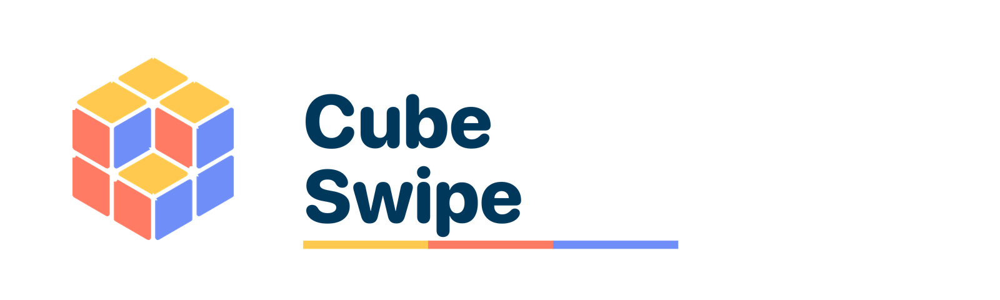

# Rombos de Propp

<picture>
  <source media="(prefers-color-scheme: dark)" srcset="brand/logo-dark.png">
  
</picture>

Versión web del puzzle magnético **Propp Lozenge**: 27 rombos de tres colores dentro de un hexágono que forman la ilusión de un cubo. Levanta grupos de tres rombos, gíralos y vuelve a dejar el cubo armado.

**Jugar:** https://patricio-garzat.github.io/Puzzle-Propp-Lozenge/

## Qué incluye

- Tableros de 2×2×2, 3×3×3 (el original) y 4×4×4.
- Dos tipos de mezcla: **En pilas** (giros de 180°, siempre se ven cubitos apilados) y **Caos total** (giros de 60°).
- **Arma tu mezcla:** el cubo empieza en blanco; pintas cada color con su cupo exacto (9 en 3×3×3), acomodas con giros y juegas desde ahí.
- Tres niveles de dificultad: Fácil (6–9 movimientos), Intermedio (15–20) y Difícil (30–35); en 4×4×4, Fácil 9–15, Intermedio 21–35 y Difícil 40–60. Se ajustan a lo que permite cada tamaño.
- Cada mezcla indica en cuántos movimientos se resuelve (el mínimo exacto cuando se puede calcular).
- Pistas que siguen el camino más corto, deshacer, récords por tamaño y atajos de teclado.
- Sonidos generados con Web Audio y animaciones; tema claro y oscuro.

## Logo e íconos

- `brand/logo-light.png` y `brand/logo-dark.png`: logo horizontal para fondos claros y oscuros.
- `icons/`: ícono de la app (SVG y PNG de 192 y 512, versión *maskable*) y favicon.
- `manifest.webmanifest` y `apple-touch-icon.png`: para instalarla en la pantalla de inicio del celular.

## Cómo funciona

Todo es un solo archivo, `index.html`, sin dependencias ni compilación. Para jugar sin internet, descárgalo y ábrelo en el navegador.

- Las posiciones se modelan como teselados por rombos de un hexágono en una red triangular.
- En el modo *En pilas*, el mínimo es el número de cubitos que faltan para completar la caja.
- En *Caos total* y en las mezclas propias, el mínimo se calcula con una búsqueda bidireccional exacta (hasta 8 movimientos).

## Créditos

Puzzle original inventado por James Propp y diseñado por Oskar van Deventer. Esta es una versión web no oficial; el puzzle físico se vende en [Puzzle Guy Store](https://puzzleguy.store/products/propp-lozenge).
